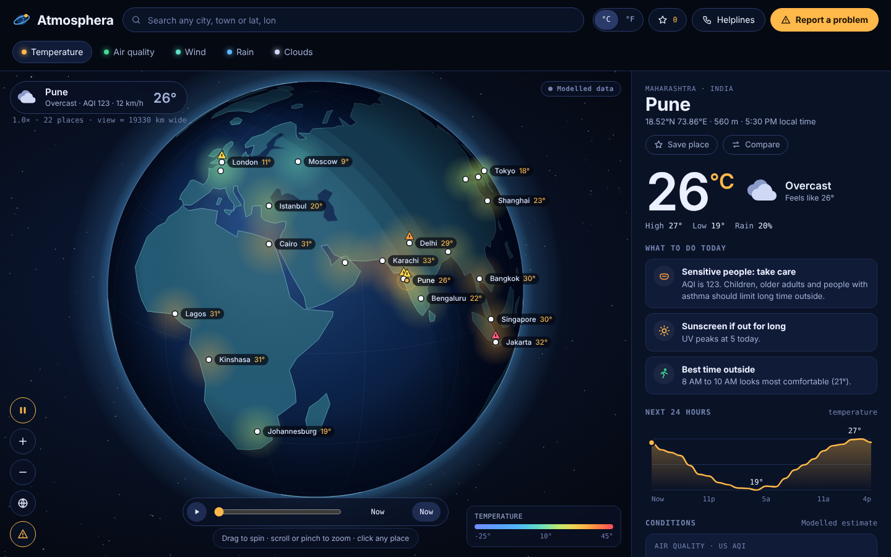

# Atmosphera

A weather and air quality web app built around a 3D globe you can spin, zoom and click.



## Features

- **3D globe:** rotatable 360° globe with 400+ cities (including many Indian, US and Canadian cities), drag, pinch or scroll to zoom up to 48×, real day and night shadow, keyboard controls.
- **Layers:** temperature, air quality, wind, rain and clouds, with a 48-hour time slider and play button.
- **City details:** current conditions, 24-hour chart, 7-day forecast, air quality (US AQI), wind, UV, sunrise and sunset, "What to do today" advice and alerts, best months to visit.
- **Saved places and compare:** star cities and compare them side by side.
- **Community reports:** report weather, air quality, flooding, buildings, roads and more, with severity, photo, "I see this too" confirmations and report status.
- **One-tap reports:** quick buttons such as "Too hot" or "Heavy rain".
- **Emergency helplines:** national numbers for ambulance and hospitals, fire and police for about 90 countries, plus map links to the nearest hospital, fire station, police station and pharmacy.
- **Share links:** the address follows the selected city.

## Run it

No install needed. Build the single page, then open it:

```bash
python3 build.py
```

This writes `index.html` from the files in `src/`. Open `index.html` in a browser. It loads D3 from a CDN, so it needs an internet connection.

## Live data

The page requests live weather and air quality from [Open-Meteo](https://open-meteo.com) (free, no key). If a request fails, it falls back to a built-in modelled estimate, and a badge at the top right shows **Live data** or **Modelled data**.

Live data needs the page to be served from a normal website or opened in a normal browser. Some embedded viewers block outside requests.

## Host it free on GitHub Pages

1. Run `python3 build.py` and commit the generated `index.html`.
2. In the repository go to **Settings → Pages**.
3. Under **Build and deployment**, choose **Deploy from a branch**, pick `main` and `/ (root)`, and save.
4. After a minute the site is live at `https://<your-username>.github.io/<repository-name>/`.

## Known limits

- Coastlines are hand-drawn and coarse. Accurate borders need Natural Earth data.
- City populations and altitudes are approximate. Many small towns are not included. GeoNames `cities15000` would fill this in.
- Community reports are saved in the visitor's own browser when hosted here. Sharing reports between visitors needs a backend.
- Helpline numbers are national emergency lines only. Check local numbers for individual hospitals.

## Project layout

```
build.py        builds index.html from src/
src/shell.html  page markup and styles
src/land.js     simplified coastline shapes
src/cities*.js  city lists
src/engine.js   weather model, units, report categories
src/live.js     Open-Meteo live data
src/panel.js    city detail panel
src/features.js alerts, advice, saved places, compare, time slider
src/helplines.js emergency numbers and quick reports
src/globe.js    3D globe rendering and interaction
src/ui.js       controls, search, report form
```
